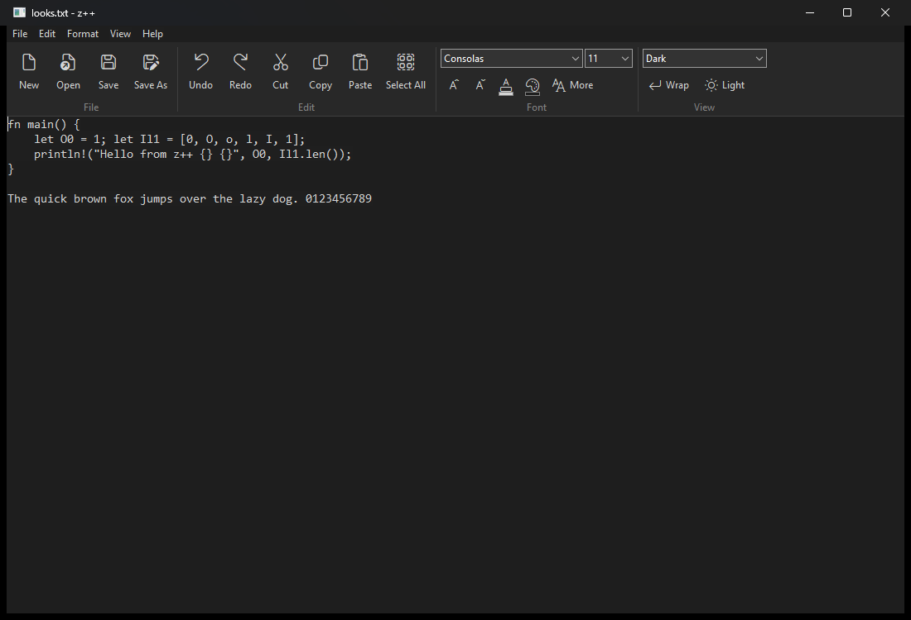
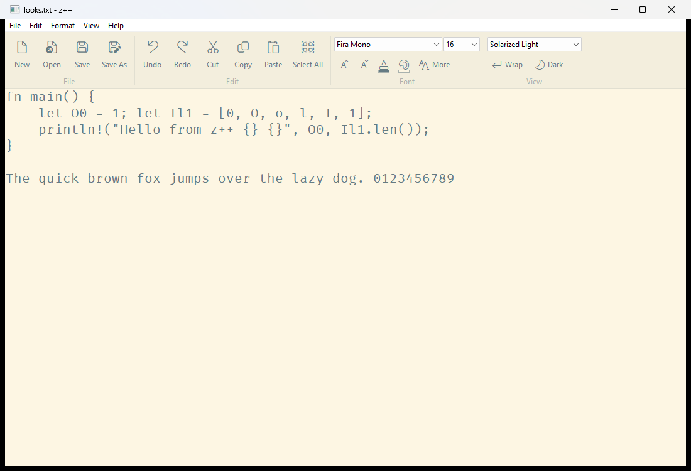
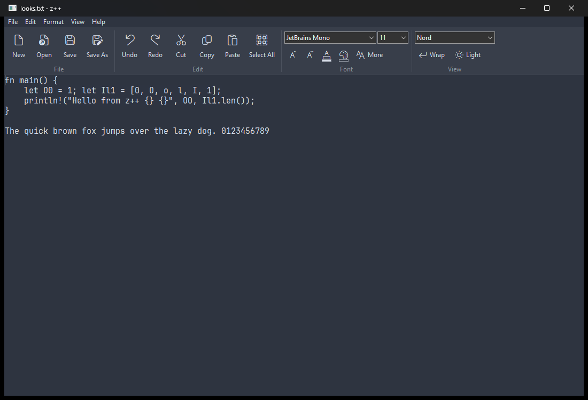

#  z++

A small, fast plain text editor for Windows, written in Rust. It runs natively on ARM64 and x64.



z++ is one exe. There is no installer and no runtime to install. It talks to the Win32 API directly and edits text with the Windows RichEdit control, so it opens fast and stays small.

The project is early. It edits plain text well, but it is not a code editor: there is no syntax highlighting. See [CHANGELOG.md](CHANGELOG.md) for what has landed.

## Features

- Tabs: each open file gets a tab with its own undo history. A dot on a tab means unsaved changes. Opening a file that is already open switches to its tab, and a file opened from Explorer while z++ is running opens as a new tab in that window (`zpp.exe --new-window` opens a second window instead).
- New, Open (several files at once), Save, Save As, Save All. Drag files onto the window to open them.
- z++ reopens last time's files and window size on start, and keeps the last 10 files under File > Recent Files.
- Saving writes to a temporary file first and swaps it in, so a crash or full disk during a save leaves the old file intact.
- If another program changes an open file, z++ reloads it when you come back. If you have unsaved edits in that tab, it asks first.
- Find, Find Next and Previous, Replace and Replace All (one undo step), and Go to Line.
- A status bar with line and column, the selection size, zoom, line endings and encoding. Click the encoding or line endings to change them; Format > Encoding and Format > Line Endings do the same.
- Files keep their encoding (UTF-8, UTF-8 with BOM, UTF-16 LE or ANSI) and their LF line endings unless you change them. z++ refuses to open a file it could not save back unchanged, such as a binary file, instead of damaging it.
- 32 color themes, including all 22 that ship with Notepad++, plus your own text and background colors. Point at a theme in View > Theme or in the toolbar's theme list and the whole window shows it right away; move off it or press Escape to go back. Dark themes also darken the title bar, menus and scroll bars.
- 11 open-licensed monospace fonts built into the exe, the usual Windows monospace fonts, and any font installed on the machine.
- A toolbar under the menu bar, grouped like the Home tab in Office: file commands, clipboard, find, font, size, colors, theme and word wrap. View > Toolbar and View > Status Bar hide those bars.
- Settings are saved per user under `HKCU\Software\z++`.

| Solarized Light with Fira Mono | Nord with JetBrains Mono |
| --- | --- |
|  |  |

## Download

Get the latest build from the [Releases page](https://github.com/suspicious-cow/z-plus-plus/releases/latest). Pick `arm64` for Windows on Arm or `x64` for Intel and AMD PCs, unzip it, and run `zpp.exe`. You can run `zpp.exe` straight from the folder, or install it for your user account (no admin rights):

```
pwsh -File install.ps1
```

The installer copies z++ to `%LOCALAPPDATA%\Programs\z++` and adds a Start menu shortcut, `zpp` in Win+R, "Edit with z++" on the right-click menu, and an entry in Settings > Apps for removing it. It registers z++ for the 91 file types that Windows Notepad and Notepad++ open, and makes z++ the default for any of them that has no default app yet. Windows 11 doesn't let an app take over a type that already has a default, such as `.txt` from Notepad, so switch those in Settings > Apps > Default apps: search for z++ there and pick it for each type. When another app can also open a type, Windows asks once the first time you open one; choose z++ and "Always". From a source checkout, run `pwsh -File scripts\install.ps1` after building.

The exe is not code-signed yet, so Windows SmartScreen may warn the first time you run it.

## Keyboard shortcuts

| Action | Keys |
| --- | --- |
| New tab, Open, Save | Ctrl+N, Ctrl+O, Ctrl+S |
| Save As | Ctrl+Shift+S |
| Close tab | Ctrl+W, or middle-click the tab |
| Next, previous tab | Ctrl+Tab, Ctrl+Shift+Tab (or Ctrl+PgDn, Ctrl+PgUp) |
| Undo, Redo | Ctrl+Z, Ctrl+Y |
| Cut, Copy, Paste, Select All | Ctrl+X, Ctrl+C, Ctrl+V, Ctrl+A |
| Find, Replace | Ctrl+F, Ctrl+H |
| Find next, previous | F3, Shift+F3 |
| Go to line | Ctrl+G |
| Bigger, smaller, reset font size | Ctrl+=, Ctrl+-, Ctrl+0 |
| Word wrap | Alt+Z |
| Switch between your last light and dark theme | Ctrl+Shift+D |

## Building

You need:

- Rust stable with the MSVC toolchain, from [rustup](https://rustup.rs).
- Visual Studio 2022 Build Tools with the C++ build tools for each target you build (ARM64 and/or x64) and a Windows 11 SDK.

Then:

```
rustup target add aarch64-pc-windows-msvc x86_64-pc-windows-msvc
cargo build --release --target aarch64-pc-windows-msvc
cargo build --release --target x86_64-pc-windows-msvc
```

The exe lands in `target\<target>\release\zpp.exe`. The C runtime is linked statically, so the exe runs on a clean Windows 11 machine.

To leave the bundled fonts out, build with `--no-default-features`. On the development machine (Windows 11 ARM64, measured 2026-11-03), the ARM64 release exe was 2.4 MB with the fonts and 361 KB without them.

Run the tests with `cargo test`.

## Code layout

| File | What it does |
| --- | --- |
| [src/window.rs](src/window.rs) | Main window, layout, commands, themes and fonts |
| [src/docs.rs](src/docs.rs) | Open files: tabs, open, save, close, reload, recent files, session |
| [src/toolbar.rs](src/toolbar.rs) | The toolbar, drawn in the current theme's colors |
| [src/tabs.rs](src/tabs.rs) | The tab strip |
| [src/statusbar.rs](src/statusbar.rs) | The status bar |
| [src/find.rs](src/find.rs) | Find and Replace |
| [src/dialog.rs](src/dialog.rs) | The Go to Line dialog |
| [src/gdi.rs](src/gdi.rs) | Drawing helpers shared by the toolbar, tabs and status bar |
| [src/menu.rs](src/menu.rs) | Menu bar, command IDs, keyboard shortcuts |
| [src/editor.rs](src/editor.rs) | The RichEdit control in plain-text mode |
| [src/file.rs](src/file.rs) | Reading and writing encodings and line endings, safe save |
| [src/themes.rs](src/themes.rs) | Theme presets and color math |
| [src/theme.rs](src/theme.rs) | Applying colors and fonts to the window, dark menu bar painting |
| [src/fonts.rs](src/fonts.rs) | Bundled fonts and the font list |
| [src/prefs.rs](src/prefs.rs) | Settings in the registry |

Dark menus rely on two undocumented uxtheme.dll functions, the same approach Notepad++ uses. If a Windows update removes them, the menus fall back to light and everything else keeps working.

## Theme colors

z++ edits plain text, so each theme is one text color and one background color. For the 22 themes that ship with [Notepad++](https://github.com/notepad-plus-plus/notepad-plus-plus/tree/master/PowerEditor/installer/themes), those two colors come from each theme file's Default Style. [scripts/import_npp_themes.py](scripts/import_npp_themes.py) reads them. No theme file is copied into z++.

## Bundled fonts

Each font is the Regular weight, embedded in the exe and loaded for z++ only. Nothing is installed on the machine. The license for each one is in [fonts/licenses](fonts/licenses).

| Font | License | Source file |
| --- | --- | --- |
| Anonymous Pro | [SIL OFL 1.1](fonts/licenses/AnonymousPro-OFL.txt) | [google/fonts](https://github.com/google/fonts/raw/main/ofl/anonymouspro/AnonymousPro-Regular.ttf) |
| Courier Prime | [SIL OFL 1.1](fonts/licenses/CourierPrime-OFL.txt) | [google/fonts](https://github.com/google/fonts/raw/main/ofl/courierprime/CourierPrime-Regular.ttf) |
| Fira Mono | [SIL OFL 1.1](fonts/licenses/FiraMono-OFL.txt) | [google/fonts](https://github.com/google/fonts/raw/main/ofl/firamono/FiraMono-Regular.ttf) |
| Go Mono | [BSD 3-Clause](fonts/licenses/GoMono-LICENSE.txt) | [golang/image](https://github.com/golang/image/raw/master/font/gofont/ttfs/Go-Mono.ttf) |
| Hack | [MIT and Bitstream Vera](fonts/licenses/Hack-LICENSE.txt) | [source-foundry/Hack](https://github.com/source-foundry/Hack/raw/master/build/ttf/Hack-Regular.ttf) |
| IBM Plex Mono | [SIL OFL 1.1](fonts/licenses/IBMPlexMono-OFL.txt) | [google/fonts](https://github.com/google/fonts/raw/main/ofl/ibmplexmono/IBMPlexMono-Regular.ttf) |
| JetBrains Mono | [SIL OFL 1.1](fonts/licenses/JetBrainsMono-OFL.txt) | [JetBrains/JetBrainsMono](https://github.com/JetBrains/JetBrainsMono/raw/master/fonts/ttf/JetBrainsMono-Regular.ttf) |
| PT Mono | [SIL OFL 1.1](fonts/licenses/PTMono-OFL.txt) | [google/fonts](https://github.com/google/fonts/raw/main/ofl/ptmono/PTM55FT.ttf) |
| Source Code Pro | [SIL OFL 1.1](fonts/licenses/SourceCodePro-OFL.txt) | [adobe-fonts/source-code-pro](https://github.com/adobe-fonts/source-code-pro/raw/release/TTF/SourceCodePro-Regular.ttf) |
| Space Mono | [SIL OFL 1.1](fonts/licenses/SpaceMono-OFL.txt) | [google/fonts](https://github.com/google/fonts/raw/main/ofl/spacemono/SpaceMono-Regular.ttf) |
| Ubuntu Mono | [Ubuntu Font Licence 1.0](fonts/licenses/UbuntuMono-UFL.txt) | [google/fonts](https://github.com/google/fonts/raw/main/ufl/ubuntumono/UbuntuMono-Regular.ttf) |

In the app, Help > Font Licenses shows all of these license texts.

## Contributing

Bug reports and ideas are welcome in [Issues](https://github.com/suspicious-cow/z-plus-plus/issues). See [CONTRIBUTING.md](CONTRIBUTING.md) before sending a pull request.

## License

The z++ source code is licensed under the [Apache License 2.0](LICENSE). The bundled fonts keep their own licenses, listed above. See [NOTICE](NOTICE).
